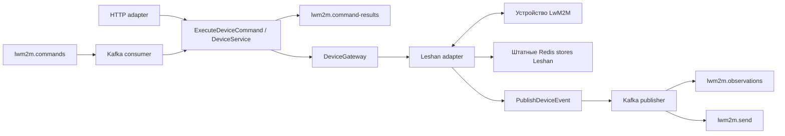

# Leshan на Spring Boot и Kotlin

LwM2M сервер с HTTP API, асинхронными Kafka-командами, публикацией Observe/Send и внешним Redis security store.
Java 21, Kotlin 2.2.21, Spring Boot 3.5.7, Leshan **2.0.0-M18** (зафиксированный milestone, без SNAPSHOT).

## Архитектура

`core` — отдельный модуль без Spring, Leshan, Jackson, Redis и Kafka. Содержит команды, результаты,
модели и порты `ExecuteDeviceCommand`, `QueryDevices`, `DeviceGateway`, `PublishDeviceEvent`, `HasLocalRegistration`.
`server` — адаптеры HTTP, Leshan и Kafka, а также сборка приложения и подключение Redis.



`ExecuteDeviceCommand.execute()` возвращает `CompletionStage<CommandResult>`. Leshan вызывается через
callback API, HTTP использует асинхронную обработку Spring MVC. Долгого ожидания устройства в servlet-потоке нет.
`commandId` связывает команду с результатом; для HTTP его можно передать в `X-Command-Id`.

Архитектура: [docs/architecture.md](docs/architecture.md).
Kafka-команды, конфигурация и примеры: [docs/kafka.md](docs/kafka.md).
Полная спецификация HTTP: [docs/openapi.json](docs/openapi.json).

## Запуск

```bash
./mvnw verify
export REDIS_URI=redis://localhost:6379
export KAFKA_BOOTSTRAP_SERVERS=localhost:9092
java -jar server/target/server-0.1.0-SNAPSHOT.jar
```

Заранее создайте Kafka топики `lwm2m.observations` и `lwm2m.send` (или переопределите имена).
Kafka key — endpoint устройства. Топики создаются инфраструктурой; приложение их не создаёт.
Для Kafka SASL/TLS можно использовать стандартные `spring.kafka.*` свойства Spring Boot.

По умолчанию HTTP слушает `8080`, CoAP UDP — `5683`, CoAPS UDP — `5684`.
На устройстве настройте адрес этого сервера и short server ID. Bootstrap API отсутствует.
Данные для DTLS-PSK читаются из заранее заполненного Redis через **RedisSecurityStore Leshan M18**.
Redis должен иметь совместимую с этой версией схему; произвольный набор ключей не подойдёт.
Каждый сервер имеет собственный store регистраций и наблюдений. По умолчанию это память процесса.
Опционально включается RedisRegistrationStore с отдельным префиксом `REGSTORE#<serverId>#`.
Security store может быть общим; регистрационные stores между серверами не объединяются.
Fan-out Kafka-команд описан ниже. Маршрутизация входящих CoAP/DTLS-пакетов относится к инфраструктуре.

| Переменная | Значение по умолчанию |
|---|---|
| `HTTP_PORT` | `8080` |
| `LWM2M_COAP_URI` | `coap://0.0.0.0:5683` |
| `LWM2M_COAPS_URI` | `coaps://0.0.0.0:5684` (пустая строка отключает CoAPS) |
| `REDIS_URI` | `redis://localhost:6379` |
| `REDIS_PREFIX` | пустая строка; общий префикс Redis-ключей |
| `REDIS_ENABLED` | `true`; `false` — локальный режим с памятью вместо Redis |
| `REGISTRATIONS_REDIS_ENABLED` | `false`; отдельный store регистраций в памяти |
| `REGISTRATIONS_REDIS_PREFIX` | пусто; при включении Redis вычисляется `<REDIS_PREFIX>REGSTORE#<serverId>#` |
| `LWM2M_MODELS_DIRECTORY` | пусто; дополнительные DDF XML модели объектов |
| `KAFKA_BOOTSTRAP_SERVERS` | `localhost:9092` |
| `KAFKA_OBSERVATION_TOPIC` | `lwm2m.observations` |
| `KAFKA_SEND_TOPIC` | `lwm2m.send` |
| `KAFKA_EVENT_BUFFER_CAPACITY` | `1000` событий |
| `KAFKA_COMMANDS_ENABLED` | `false`; включает приём команд и публикацию результатов |
| `LWM2M_SERVER_ID` | обязателен при включении команд или Redis-регистраций; уникален для сервера |
| `KAFKA_COMMAND_GROUP_ID` | `lwm2m-server-<serverId>`; собственная стабильная group каждого сервера |
| `KAFKA_COMMAND_TOPIC` | `lwm2m.commands` |
| `KAFKA_COMMAND_RESULT_TOPIC` | `lwm2m.command-results` |
| `KAFKA_COMMAND_INVALID_TOPIC` | `lwm2m.commands.invalid` |
| `KAFKA_COMMAND_MAX_IN_FLIGHT` | `100` одновременно выполняющихся Kafka-команд |
| `KAFKA_COMMAND_RESULT_BUFFER_CAPACITY` | `1000` результатов/ошибок сообщений в памяти |

Для запуска Kafka-команд дополнительно создайте три command-топика и задайте:

```bash
export KAFKA_COMMANDS_ENABLED=true
export LWM2M_SERVER_ID=node-A
export KAFKA_COMMAND_MAX_IN_FLIGHT=100
```

Kafka consumer вызывает асинхронный `send`, затем синхронно коммитит offset без ожидания ответа.
При достижении лимита выполняется `pause`; `poll` продолжается, после освобождения слота выполняется
`resume`. Очередей и последовательности по устройствам нет. Команды одному устройству могут
перекрываться; результаты могут приходить в другом порядке. Состояние команд и дедупликация отсутствуют.
Подробности последствий сбоев и контракт — в [docs/kafka.md](docs/kafka.md).

## HTTP API

`B = /api/clients/{endpoint}`. `{path}` содержит сегменты пути LwM2M без начального `/`.

| Метод | Маршрут | Операция |
|---|---|---|
| GET | `/api/clients` | Список регистраций |
| GET | `B` | Регистрация устройства |
| GET | `B/{path}` | Read |
| GET | `B/{path}/discover` | Discover |
| PUT | `B/{path}` | Write; `replace=true` или `false` |
| PUT | `B/{path}/attributes?pmin=0&pmax=60` | Write Attributes |
| POST | `B/{objectId}/{instanceId}/{resourceId}` | Execute; тело — строка аргументов LwM2M |
| POST | `B/{objectId}` или `B/{objectId}/{instanceId}` | Create |
| DELETE | `B/{objectId}/{instanceId}` | Delete |
| POST | `B/{path}/observe` | Observe |
| DELETE | `B/{path}/observe` | Cancel Observe |
| GET | `B/composite?paths=/3/0/0,/3/0/1` | Read Composite |
| PUT | `B/composite` | Write Composite |
| POST | `B/composite/observe?paths=...` | Observe Composite |
| DELETE | `B/composite/observe?paths=...` | Cancel Observe Composite |

Composite требует LwM2M 1.1 и соответствующих возможностей устройства.
`timeout` — целое число секунд, по умолчанию 5, диапазон 1–300.
`format` — имя формата Leshan (например `TLV`, `SENML_CBOR`); для Composite — `pathformat`, `nodeformat`
(по умолчанию оба `SENML_CBOR`).
`active=true` отправляет явную отмену подписки устройству. Без параметра выполняется локальная отмена.
Локальная отмена идемпотентна; активная отмена отсутствующей подписки возвращает `404`.

Сохраняются маршруты и операции Demo Server. JSON ответа — собственный конверт `CommandResult`,
а не побайтовая совместимость с Demo UI. Ответ устройства, включая отказ, возвращается с HTTP `200`:
проверяйте `response.success` и `response.status` (исходный код Leshan).
Ошибки сервера или транспорта возвращаются с соответствующим HTTP кодом и полем `error`.

```bash
curl http://localhost:8080/api/clients
curl http://localhost:8080/api/clients/device-001/3/0/0
curl -X POST http://localhost:8080/api/clients/device-001/3/0/13/observe
curl -X PUT 'http://localhost:8080/api/clients/device-001/3/0/13?timeout=10' \
  -H 'Content-Type: application/json' -H 'X-Command-Id: example-001' \
  -d '{"id":13,"kind":"singleResource","type":"TIME","value":1794900000}'
```

Write и Create принимают `Node`. `kind`: `singleResource`, `multipleResource`, `resourceInstance`,
`instance`, `object`. Поля экземпляра: `id`, `resources`; объекта: `id`, `instances`.
Ресурс: `id`, `type`, `value`; множественный ресурс: `id`, `type`, `values` с ID экземпляров как ключами.
Для Create с назначением ID устройством передайте `id=-1`, `kind=instance`.
Write Composite принимает объект `{ "/path": Node, ... }`.

Типы: `STRING`, `INTEGER`, `UNSIGNED_INTEGER`, `FLOAT`, `BOOLEAN`, `TIME`, `OPAQUE`, `OBJLNK`, `CORELINK`.
`TIME` — секунды Unix (допустимы миллисекундные доли), `OPAQUE` — base64, `OBJLNK` — `3:0`,
`CORELINK` — строка CoRE Link Format, `UNSIGNED_INTEGER` — десятичная строка без потери точности.
Write ресурса также поддерживает `text/plain` как строковое значение.
Чтобы сбросить атрибут, передайте параметр без значения: `?pmin`.

## Queue Mode и ошибки

Бодрствующее устройство в Queue Mode обслуживается обычно. Спящее получает `409 DEVICE_SLEEPING`.
Команда не попадает в очередь, не повторяется при пробуждении. Leshan повторно проверяет доступность
при отправке, поэтому засыпание между проверкой и отправкой также возвращает ошибку.
Просмотр регистраций и локальная отмена подписок доступны во время сна.

`400 INVALID_REQUEST`, `404 DEVICE_NOT_FOUND/SUBSCRIPTION_NOT_FOUND`, `409 DEVICE_SLEEPING/COMMAND_EXPIRED`,
`504 TIMEOUT`, `502 REQUEST_REJECTED/REQUEST_CANCELLED/INVALID_RESPONSE`, `500 INTERNAL_ERROR`.
CoAP retransmission внутри одной операции сохраняется; она не является отложенной повторной командой.

## Kafka

Observe публикует начальное значение и последующие уведомления. `subscriptionId` возвращается в HTTP
и совпадает с полем событий; `commandId` соответствует исходной команде Observe.
Ошибки и отмена подписок имеют типы `OBSERVATION_ERROR`, `OBSERVATION_CANCELLED`.
Send имеет тип `SEND` и отдельный топик. Все временные срезы Send публикуются отдельно с `deviceTimestamp`.

```json
{
  "schemaVersion": 1,
  "eventId": "uuid",
  "type": "OBSERVATION_VALUE",
  "endpoint": "device-001",
  "registrationId": "registration-id",
  "subscriptionId": "registration-id:observation-id",
  "commandId": "command-id",
  "receivedAt": "2026-11-17T15:00:00Z",
  "paths": ["/3/0/13"],
  "lwm2mCode": "CONTENT(205)",
  "data": {"/3/0/13": {"id":13,"kind":"singleResource","type":"TIME","value":1794900000}}
}
```

Доставка best effort: ограниченная очередь в памяти и штатные повторы Kafka producer в течение 30 секунд.
Нет outbox, дискового буфера и восстановления событий после перезапуска. Переполнение очереди приводит
к отбрасыванию нового события. Успешная LwM2M операция не означает, что Kafka уже приняла событие.
Ошибки Kafka не меняют результат операции устройства. `eventId` идентифицирует событие; сквозная
гарантия exactly-once не заявляется. Метрики: `lwm2m.events.published`, `.failed`, `.dropped`.

## Проверки

`./mvnw verify` запускает тесты ядра, конвертации типов, отказа Kafka и интеграционные тесты:
реальный Leshan клиент подключается по CoAP, управляется через HTTP, а события читаются из встроенного
Kafka broker. Проверяются все 15 групп API, Composite, Send, активная отмена, сон и отсутствие
отложенного Execute после пробуждения. Kafka-команды проверяются на двух серверах с отдельными
регистрациями: fan-out, Read Composite, Observe/Cancel, сон, истечение срока, тайм-аут, некорректные
сообщения и pause/resume на лимите. Отдельно проверяются порядок send/commit и ключи Redis.
Внешние Kafka, Redis и Docker для этих тестов не требуются; Redis-проверки используют mock Jedis.

REST не содержит управления security, bootstrap, SSE или веб-интерфейса.
