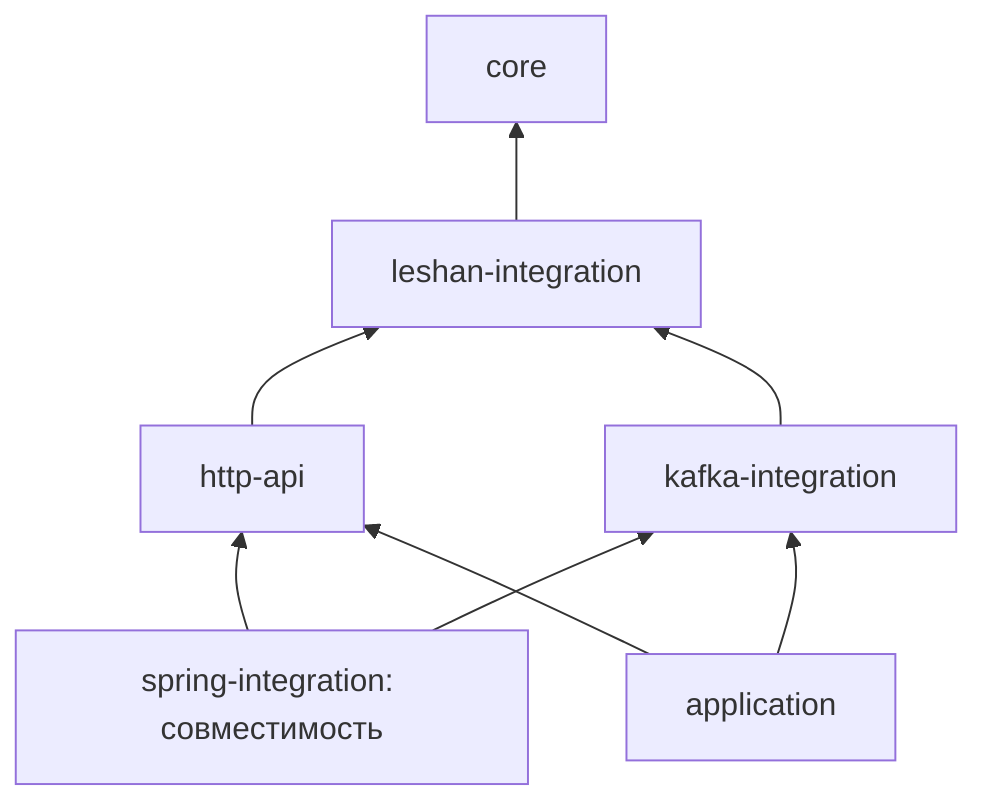

# Архитектура сервера

Проект разделён на модули с направленными зависимостями:

`leshan-integration` содержит адаптер Leshan, NodeMapper, общий JSON mapper, настройки и базовую
Spring-автоконфигурацию. `http-api` содержит контроллеры, обработку HTTP-ошибок и REST-автоконфигурацию.
`kafka-integration` содержит контракты Kafka, consumer, publishers, метрики, опциональный health и
Kafka-автоконфигурации. `http-api` не зависит от Kafka или Micrometer core; `kafka-integration` не
зависит от HTTP, MVC или Servlet API. Каждый адаптер объявляет собственный AutoConfiguration.imports.

`spring-integration` сохраняется как объединяющая зависимость без собственных классов и
автоконфигураций. Имена классов, beans, HTTP-пути и свойства конфигурации сохранены. Этот артефакт
теперь транзитивно подключает MVC и Kafka; для минимального classpath выбирайте отдельный модуль.

Библиотеки обнаруживаются через Spring Boot AutoConfiguration.imports и требуют готовый bean
LeshanServer (один или отмеченный Primary). Сервер, stores и транспортные endpoints предоставляет хост.
Standalone-приложение предоставляет этот bean и управляет его запуском, остановкой и уничтожением.
Gateway attach/detach устанавливает и снимает только listeners интеграции, без вызовов lifecycle сервера.

`core` не зависит от Spring, Kafka, Redis, Jackson или Leshan. `DeviceService` реализует входные порты
`ExecuteDeviceCommand` и `QueryDevices`. Через выходной `DeviceGateway` выполняются операции устройства.
Здесь проверяются срок действия, таймаут, наличие регистрации и сон устройства.

HTTP и Kafka используют один `ExecuteDeviceCommand` с результатом `CompletionStage<CommandResult>`.
Leshan adapter вызывает callback API `send`; ожидание ответа не удерживает servlet- или Kafka-поток.
Конвертация запросов, узлов, ответов и исключений протокола находится в Leshan adapter.

`HasLocalRegistration` предоставляет Kafka adapter проверку регистрации в собственном store.
`PublishDeviceEvent` отделяет телеметрию от Kafka. Внешние envelope, версии схем, топики,
публикация результатов и управление offset принадлежат Kafka adapter.

## Fan-out и stores

Каждый сервер читает один command-топик через свою стабильную consumer group. Сервер с регистрацией
endpoint в собственном store вызывает use case. Остальные подтверждают offset без результата.
При отсутствии регистрации на всех серверах результат не публикуется; отправитель использует свой тайм-аут.
Если endpoint зарегистрирован на нескольких серверах, каждый из них выполнит команду. Глобальной
координации и гарантии единственного владельца нет.

Security store Redis может быть общим. Регистрации и наблюдения по умолчанию находятся в памяти
конкретного процесса. Для Redis-регистраций задаётся отдельный префикс каждого сервера.
Метки владельца или запуска в регистрации не добавляются. Команды в Redis не сохраняются.

## Выполнение, offset и ограничение нагрузки

Поток consumer единолично вызывает `poll`, `pause`, `resume` и `commitSync`. `max.poll.records=1`
позволяет останавливаться точно на лимите без прикладной очереди команд.

Для корректной локальной команды:

1. Увеличивается счётчик выполняющихся операций.
2. Вызывается `ExecuteDeviceCommand.execute`, который инициирует Leshan `send` либо возвращает
   немедленную ошибку проверки (например, `DEVICE_SLEEPING`, `COMMAND_EXPIRED`).
3. Выполняется `commitSync` с offset следующего сообщения. Ответ устройства для коммита не ожидается.
4. Callback завершения отправляет результат в ограниченный буфер publisher и освобождает слот.

Быстрый ответ может прийти во время коммита. Callback публикации подключается после попытки коммита;
ошибка коммита не отменяет уже отправленную операцию.

При достижении `max-in-flight` приостанавливаются назначенные partitions. Consumer продолжает `poll`,
обслуживая consumer group. При освобождении слота чтение возобновляется. Тайм-ауты и ошибки также
освобождают слоты. Лимит относится к Kafka-командам; HTTP использует существующий независимый путь.

Последовательности по endpoint нет: несколько операций одному устройству могут выполняться одновременно.
Порядок результатов не гарантирован. Зависимые операции связывает отправитель, ожидая предыдущий результат.

## Последствия сбоев

Состояние команд, дедупликация и outbox отсутствуют. `commandId` служит только для корреляции.
Повтор сообщения с тем же ID запускает новую операцию.

- Сбой между `send` и успешным commit допускает повторную доставку и выполнение команды.
- Сбой после commit может потерять результат; команда автоматически не восстанавливается.
- Ошибка commit останавливает consumer без цикла повторного `send`; health становится DOWN.
  После перезапуска возможен replay неподтверждённого входа.
- Ошибки Kafka publisher не вызывают устройство заново. Результаты повторяются только внутри штатной
  политики Kafka producer; по окончании попыток либо при переполнении буфера возможна потеря.

Сон завершает команду ошибкой сразу; ожидания пробуждения нет. Тайм-аут Leshan отменяет дальнейшие
CoAP-ретрансмиссии, но не отменяет уже выполненное действие на устройстве. Exactly-once не заявляется.

Контракт и конфигурация: [kafka.md](kafka.md).
Выбор модулей и подключение библиотеки: [embedding.md](embedding.md).
